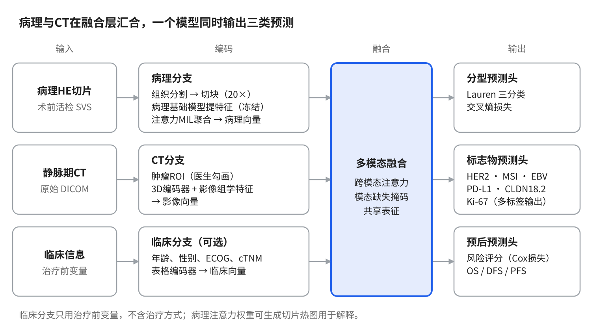

# 胃癌多模态AI预测模型 课题设计书

更新：2026-10-31。模型与开发规则的最终版本以仓库根目录的 `CLAUDE.md` 为准。

# 一、研究背景与目标

本课题利用**治疗前**的胃镜活检 HE 切片和静脉期增强 CT，构建一个多模态、多任务 AI 模型，在治疗开始之前同时预测 Lauren 分型、6 项生物标志物和患者预后，并在 3 个独立外部中心验证。

## 要解决的临床问题

- **术前信息不足。** 活检组织量少，Lauren 分型常与术后结果不一致；HER2、MSI、EBV、PD-L1、Claudin18.2 等需要额外的免疫组化或分子检测，耗时、消耗组织，部分活检标本无法完成全部检测。
- **治疗决策前移。** 新辅助化疗、靶向治疗（HER2、Claudin18.2）和免疫治疗（MSI、EBV、PD-L1）的选择都需要在治疗前了解肿瘤的分子特征。
- **术前预后评估有限。** 治疗前只能依据临床分期（cTNM），区分度不足。

## 研究目标

1. **主要目标：** 构建并多中心验证一个基于术前病理和 CT 的胃癌多模态多任务模型。
2. **三项预测任务：**
    1. 分型：Lauren 分型
    2. 生物标志物：HER2、MSI、EBV、PD-L1、Claudin18.2、Ki-67
    3. 预后：总生存期及无病/无进展生存期的风险分层
3. **探索性目标：** 评估模型对治疗获益的预测价值，重点是新辅助治疗和免疫治疗。

## 创新点

- **术前、常规材料。** 只用常规活检切片和常规 CT，不增加额外检查。
- **病理与影像融合。** 微观组织形态和宏观肿瘤影像互补，并允许单一模态缺失。
- **一个模型、多个任务。** 分型、标志物、预后共享表征，联合学习。
- **大样本多中心。** 4 个中心 3200 余例，3 个完全独立的外部验证队列。
- **从预后走向疗效预测。** 探索模型与新辅助治疗、免疫治疗获益之间的关系。

# 二、研究队列与数据

研究共纳入 4 个中心约 3200 例胃癌患者，每例有 1 张术前 HE 活检切片（SVS 格式）和配对的术前增强 CT；内部中心用于建模，其余 3 个中心只用于最终的独立验证。

| 队列 | 例数 | 用途 |
|:---|:---|:---|
| 内部中心 | 约 2000 | 按病人 8:2 划分：约 1600 例训练（5 折交叉验证调参），约 400 例内部测试 |
| 外部验证 1 | 约 500 | 独立测试 |
| 外部验证 2 | 约 500 | 独立测试 |
| 外部验证 3 | 约 200 | 独立测试 |

外部队列在模型最终定型前不参与任何训练、调参或阈值选择。

## 纳入标准（草案）

- 病理确诊为胃腺癌。
- 有**治疗前**的 HE 活检切片，扫描为 SVS 格式。
- 有**治疗前**的增强 CT，且包含静脉期；与活检的间隔建议不超过 4 周（待确认）。
- 至少有一项分型、生物标志物或随访标签。

## 排除标准（草案）

- 活检或 CT 检查前已接受任何抗肿瘤治疗。
- 合并其他恶性肿瘤。
- 切片质量不合格：严重模糊、褶皱，或肿瘤组织过少。
- CT 质量不合格：明显伪影，或无法辨认肿瘤。

## 数据模态

- **病理：** 术前胃镜活检 HE 切片，每人 1 张，SVS 格式。
- **CT：** 以**静脉期（门静脉期）**为主，原始 DICOM 格式；动脉期作为可选扩展。理由是静脉期肿瘤与正常胃壁对比最好，是胃癌分期的标准期相，各中心可得性最高，跨中心差异相对小。
- **临床信息：** 治疗前的基线变量（年龄、性别、ECOG、肿瘤部位、cTNM 等），以及治疗和随访信息。

## 人群构成（已知部分）

- 根治性手术患者约占 85%，不可切除的晚期患者约占 15%（约 480 例）。
- 接受免疫治疗约 400 例。
- 接受新辅助治疗的例数待统计。

# 三、预测任务定义

分型和生物标志物共 7 个预测目标，每个目标设一个主要定义用于主分析，必要时加补充定义；缺失的标签不计入损失，因此 3200 例都能参与训练。

| 任务 | 主要定义 | 补充分析 | 临床意义 |
|:---|:---|:---|:---|
| Lauren 分型 | 三分类：肠型 / 弥漫型 / 混合型 | 二分类：肠型 vs 非肠型 | 与预后、手术范围、化疗敏感性相关 |
| HER2 | 阳性（IHC 3+，或 2+ 且 FISH 阳性）vs 阴性 | 三分类：HER2 0 / HER2-low / 阳性 | 抗 HER2 靶向治疗；HER2-low 与新型 ADC 药物相关 |
| MSI | MSI-H/dMMR vs MSS/pMMR | — | 免疫治疗获益人群，预后较好 |
| EBV | EBER 原位杂交阳性 vs 阴性 | — | 免疫治疗敏感的独立分子亚型 |
| PD-L1 | CPS ≥5 vs <5 | CPS ≥1、≥10 两个阈值 | 免疫治疗决策 |
| Claudin18.2 | 阳性（≥75% 肿瘤细胞中到强膜染色）vs 阴性 | — | 抗 Claudin18.2 靶向治疗 |
| Ki-67 | 二分类，阈值取队列中位数或文献常用值（待定） | 直接回归预测百分比 | 增殖活性，作为次要任务 |

## 标签质量要点

1. **检测方法要记录到每个中心。** PD-L1 的抗体克隆（22C3、28-8、SP263 等）、MSI 的检测方式（MMR 免疫组化或 PCR/NGS）、Claudin18.2 的抗体与判读标准，均需逐中心登记；方法不同的结果不能直接混用，必要时按方法分层分析。
2. **标签来源要写清楚。** 记录每项检测是在活检标本还是手术标本上完成的。模型输入是活检，若标签来自手术标本，即为"用术前活检预测整体肿瘤状态"，临床价值更高，但需在论文中说明。HER2 和 PD-L1 的瘤内异质性较大，是主要误差来源之一。
3. **新辅助治疗患者需特殊处理。** 新辅助治疗后，手术标本的形态和标志物表达可能改变，Lauren 分型也可能难以判断。这部分患者的标签应优先使用治疗前活检的检测结果；只有术后结果的，标记为"新辅助后"，主分析中按缺失处理，另作敏感性分析。
4. **低阳性率标志物。** EBV、MSI 阳性率低，训练时使用类别加权或过采样；评价时除 AUC 外报告 PR 曲线下面积、敏感度和特异度，所有指标给出 95% 置信区间。

# 四、预后分析与治疗异质性处理

模型只用治疗前数据输出一个"基线风险评分"，治疗方式不作为模型输入，而是在统计分析中校正和分层；手术与不可切除两类人群分开评价，新辅助和免疫治疗作为探索性亚组。

## 人群与终点

| 人群 | 约例数 | 主要终点 | 次要终点 |
|:---|:---|:---|:---|
| 根治性手术（含新辅助后手术） | 约 2700（85%） | 总生存期 OS | 无病生存期 DFS |
| 不可切除 / 晚期 | 约 480（15%） | 总生存期 OS | 无进展生存期 PFS |

- **OS 起点：** 建议统一为病理确诊日期，因为模型在治疗前使用；也可报告以手术日期为起点的结果。
- **DFS：** 从手术到复发或任何原因死亡。
- **PFS：** 从一线治疗开始到疾病进展或任何原因死亡。
- 需统一随访截止日期。

## 三层分析策略

1. **基线风险模型（主分析）。** 评价 C-index、1/3/5 年时间依赖 AUC，按风险评分高低分组绘制 KM 曲线并做 log-rank 检验。在两类人群中分别评价。
2. **证明风险评分是独立预后因素（必做）。**
    1. 多因素 Cox 回归：风险评分 + cTNM + 年龄 + ECOG + 治疗方式；以中心作为分层变量（分层 Cox）。
    2. 亚组分析：按分期、治疗方式、中心分别验证。
    3. 将风险评分与 cTNM 结合做列线图，比较与单独 cTNM 的 C-index，并做校准曲线和决策曲线分析。
3. **治疗获益探索（论文亮点）。** 检验"风险评分 × 治疗方式"的交互作用，例如高风险者是否从新辅助或辅助化疗中获益更多。

## 新辅助治疗亚组

- 确保输入的活检和 CT 都是新辅助治疗**之前**的。
- 增加一个探索性任务：预测新辅助治疗后的病理缓解（肿瘤退缩分级 TRG，或病理完全缓解 pCR）。
- 需收集：新辅助方案、周期数、TRG 分级。

## 免疫治疗亚组（约 400 例）

- 先登记治疗场景：新辅助 / 围手术期、术后辅助、晚期一线或后线。不同场景分开分析，例数太少的场景合并或只做描述。
- 分析模型预测的 MSI、EBV、PD-L1 状态及风险评分与免疫治疗疗效（OS、PFS、客观缓解率）的关系。
- 与未接受免疫治疗的患者比较时，用倾向性评分匹配或加权减少治疗选择偏倚，并做交互作用检验。
- 这部分是回顾性探索，结论表述为"提示"而非"证实"。

# 五、模型架构

病理、CT、临床三个分支分别编码，在融合层汇合成共享表征，再由三个输出头同时完成分型、标志物和预后预测。



- **病理分支：** 用公开的病理基础模型（如 UNI、CONCH、Virchow 系列，最终选择取决于效果和权重获取情况）冻结提取图块特征；活检组织量少，聚合模块选用适合少量图块的注意力多示例学习（如 ABMIL、TransMIL）。
- **CT 分支：** 以医生标注的肿瘤中心点（或审核后的肿瘤分割）为中心裁剪三维区域，用 3D 卷积或 Transformer 编码器提取特征，可加载医学影像预训练权重；影像组学特征作为并行输入或对照。
- **临床分支（可选）：** 主模型可只用病理 + CT，临床变量放到列线图阶段结合，这样更容易证明影像本身的独立价值。
- **融合层：** 跨模态注意力；缺失的模态用可学习的占位向量代替并屏蔽，保证只有单一模态时也能预测。
- **输出头：** 分型用交叉熵损失；标志物为多标签输出，缺失标签不计损失；预后用 Cox 部分似然损失输出风险评分。

# 六、训练与验证方案

训练分两步：先用冻结的病理基础模型对全部切片一次性提取特征，再在特征上训练聚合、融合和多任务模块；所有比较都在同一划分下完成，外部队列只在最后使用一次。

## 数据划分

- 按**病人**划分，按 Lauren 分型和主要标志物分层，保证各集合阳性比例接近。
- 内部 1600 例做 5 折交叉验证选模型和超参数；内部 400 例和 3 个外部队列只做最终测试。

## 预处理与训练策略

- **病理：** 组织区域自动分割，20× 下切块；用染色增强或染色归一化减小中心间差异。
- **CT：** 统一重采样（体素大小根据层厚分布确定），按腹部软组织窗截断 CT 值并标准化，以肿瘤 ROI 为中心裁剪三维区域。
- **多任务损失：** 各任务损失加权求和，权重用不确定性加权自动学习或手动调节；缺失标签以掩码屏蔽。
- **模态缺失：** 训练时随机丢弃某一模态，使模型在只有病理或只有 CT 时也能工作。

## 对照模型与消融实验

- 单模态模型：只用病理、只用 CT。
- 临床模型：只用 cTNM 等临床变量。
- 消融：去掉多任务（每个任务单独训练）、去掉跨模态注意力（简单拼接）。

## 评价指标与统计

| 任务类型 | 主要指标 | 补充 |
|:---|:---|:---|
| 分类（分型、标志物） | AUC（95% CI） | PR 曲线下面积、敏感度、特异度、校准曲线 |
| 预后 | C-index（95% CI） | 时间依赖 AUC、KM 曲线、决策曲线 |

- 置信区间用 bootstrap 计算；AUC 比较用 DeLong 检验。
- 报告遵循 TRIPOD+AI 规范。

## 可解释性

- 病理：注意力权重生成切片热图，请病理医生判读高关注区域是否对应有意义的形态。
- CT：类激活图显示模型关注的影像区域。

# 七、技术实施

代码由 Claude 编写，研究者在不联网的 GPU 服务器上运行；患者数据始终不离开内网，Claude 只接触去除身份信息的日志和汇总结果。

## 协作流程

1. Claude 生成完整代码文件，研究者下载后经 U 盘或内网传到服务器。
2. 每个模块先用 3–5 例做冒烟测试，确认能跑通再跑全量。
3. 研究者把日志或报错文本发回，去掉姓名、住院号等身份信息。
4. Claude 定位问题、修改代码，循环迭代。
5. 服务器上用 git 管理代码版本，任何改动都可回退。

## 离线环境准备

- **依赖包：** 在系统相同的联网机器上下载 wheel 包，或打包 conda 环境 / Docker 镜像，整体拷入。
- **预训练权重：** 病理基础模型和 CT 编码器的权重提前下载后拷入；部分模型需在 Hugging Face 申请访问权限。代码一律从本地路径加载。
- **数据脱敏：** 服务器上保留"住院号 ↔ 研究编号"对照表，代码和日志只使用研究编号。

## 代码结构

```
gastric_mm/
├── configs/       # 路径与超参数，研究者只需改这里
├── preprocess/    # 切片分块、病理特征提取、CT 预处理、临床数据清洗
├── models/        # 病理/CT/临床编码器、融合模块、多任务输出头
├── train.py
├── eval.py
├── utils/         # 指标、生存分析、日志、可视化
└── scripts/       # 一键运行脚本
```

# 八、研究阶段与时间安排

全流程粗估 9–12 个月；最耗时的是 CT 肿瘤勾画和标签整理，可与环境搭建、病理特征提取并行进行。以下时长为初步估计，按实际人力调整。

| 阶段 | 内容 | Claude 负责 | 研究团队负责 | 预计时长 |
|:---|:---|:---|:---|:---|
| 0 | 数据整理与 CT 勾画 | 数据收集表、勾画规范 | 整理标签与随访、影像科勾画 | 2–3 个月 |
| 1 | 离线环境搭建 | 依赖清单与安装方案 | 下载并拷入服务器安装 | 约 2 周 |
| 2 | 预处理与特征提取 | 切块、特征提取、CT 预处理代码 | 运行（病理特征只需提取一次） | 约 1 个月 |
| 3 | 单模态基线 | 单模态模型与评估代码 | 训练并反馈结果 | 1–1.5 个月 |
| 4 | 多模态多任务模型 | 融合与多任务框架、消融实验 | 训练并与基线对比 | 1.5–2 个月 |
| 5 | 外部验证与统计 | 评估、生存分析、作图代码 | 外部验证、出图 | 1–1.5 个月 |
| 6 | 论文撰写 | 方法、结果、讨论初稿 | 修改定稿、投稿 | 1–2 个月 |

# 九、待确认事项

- ☑ 服务器环境：2 张 40GB GPU（A100 / A800），Python 与 PyTorch 已安装
- ☐ 4 个中心静脉期 CT 是否齐全，层厚与机型分布（运行 DICOM 汇总脚本确认）
- ☑ CT 方案已定：医生为全部病例标注肿瘤中心点；部分病例完整三维勾画，训练 nnU-Net 自动分割其余病例并由医生审核
- ☐ 各中心 PD-L1 抗体克隆、MSI 检测方法、Claudin18.2 抗体与判读标准
- ☐ 每项标志物检测用的是活检还是手术标本
- ☐ 新辅助治疗例数，及其标签是否有治疗前结果
- ☐ 免疫治疗约 400 例的治疗场景分布
- ☐ Ki-67 二分类阈值
- ☐ 随访起点、终点定义和随访截止日期
- ☐ 多中心伦理审批与数据共享协议

# 十、已确定的技术方案（2026-10-31）

1. **病理特征提取器：** 可插拔支持多个公开病理基础模型，先在内部训练集子集上用 Lauren 和 MSI 比较 2–3 个后选定。
2. **病理聚合：** 门控注意力 MIL（ABMIL）为主，TransMIL 为对比。
3. **CT 区域：** 医生为每例标注肿瘤中心点，以该点为中心裁剪三维区域（主方案）；部分病例完整三维勾画，训练 nnU-Net 自动分割其余病例，医生审核修正。
4. **CT 编码：** 先用预训练三维 CT 编码器冻结提特征，再视收益决定是否端到端微调；影像组学作为基线。
5. **融合：** 模态 token + 小型 Transformer 跨模态注意力，缺失模态掩码；简单拼接作为对照。
6. **生存损失：** 离散时间生存损失为主，Cox 为对比。
7. **训练策略：** 先单模态训练，再初始化融合模型；多任务损失不确定性加权。
8. **算力：** 2 张 40GB GPU，BF16 混合精度，一卡一实验。
